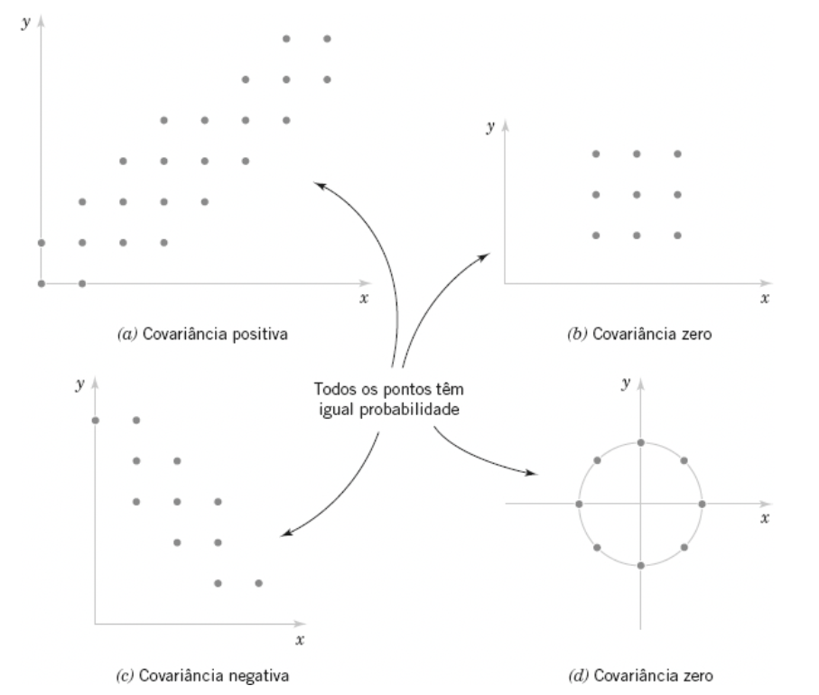

# Motivação

Estudamos até então distribuições de probabilidade para uma única variável aleatória. É frequentemente útil ter mais de uma variável aleatória definida em um experimento aleatório.

Exemplo: $X$ denota a variável aleatória para o comprimento de uma dimensão de uma peça moldada por injeção, enquanto $Y$ denota o comprimento de uma outra dimensão.
Se queremos saber a chance da peça vir com $X$ de 2,95 a 3,05 e $Y$ vir de 7,6 a 7,80 milímetros, temos formalmente $P(2,95 < X < 3,05 \text{ e } 7,6 < Y < 7,8)$, ou melhor, se definimos uma região $R = [2,95; 3,05] \times [7,6;7,8]$, queremos $P((X,Y) \in R)$. 

⚠️ $R$ pode ter formatos não retangulares também... como uma condição $x < y$ ou mesmo uma função de restrição (*constraint*)

# Funções de probabilidade

> (Definição) A função de probabilidade conjunta das variáveis aleatórias discretas $X$ e $Y$, denotada por $f_{XY}(x,y)$, satisfaz
> 1. $f_{XY}(x,y) \geq 0$
> 2. $\sum_X \sum_Y f_{XY}(x,y) = 1$
> 3. $f_{XY}(x,y) = P(X = x, Y = y)$

> (Definição) Uma função densidade de probabilidade conjunta para variáveis aleatórias contínuas $X$ e $Y$, denotada como $f_{XY}(x,y)$, satisfaz
> 1. $f_{XY}(x,y) \geq 0 \quad \forall \ x,y$
> 2. $\int_{-\infty}^\infty \int_{-\infty}^\infty f_{XY}(x, y) dx dy = 1$
> 3. ${\int \int}_R f_{XY}(x, y) dx dy$

---

Exemplo: Seja $X$ uma variável aleatória que denota o tempo (em milissegundos) até um servidor de computador se conectar à sua máquina, e seja $Y$ o tempo (em milissegundos) até o servidor autorizá-lo como um usuário válido. Cada uma dessas variáveis aleatórias mede a espera a partir de um tempo inicial comum e $X < Y$. Considere que a função densidade de probabilidade conjunta para $X$ e $Y$ seja

$$f_{XY}(x,y) = 6 \times 10^{-6} \exp(-0,001x - 0,002y) \text{ para } x < y$$

Mostre que é uma função densidade de probabilidade válida e determine $P(X < 1000, Y < 2000)$.

---

> (Definição) Se $X$ e $Y$ são variáveis aleatórias, com função de probabilidade (ou densidade) conjunta $f_{XY}(x,y)$, então as funções de probabilidade marginal de $X$ e $Y$ são
> $$f_X(x) = \int f_{XY} (x,y) dy$$
> e
> $$f_Y(y) = \int f_{XY} (x,y) dx$$

Com isso, podemos dizer que a função de probabilidade marginal de $X$, é simplesmente a função (densidade) de probabilidade de $X$ de forma independente de $Y$.
Ou seja:
$$P(a < X < b) = \int_a^b f_X(x) dx = \int_a^b \int_{-\infty}^\infty f_{XY} (x,y) dy dx$$

# Valor esperado

De forma geral, para uma função $g(X,Y)$, temos que o valor esperado é dado por:

- Caso discreto: $E\{g(X,Y)\} = \sum_X \sum_Y g(x,y) f(x, y)$
- Caso contínuo: $E\{g(X,Y)\} = \int_{-\infty}^\infty \int_{-\infty}^\infty g(x,y) f(x, y) dx dy$

⚠️Veja que independentemente de $(X,Y)$ ser um vetor, o valor esperado é um escalar!

## Casos especiais - Simplificação

Usando a função de probabilidade marginal, podemos computar diretamente os valores esperados de cada uma das variáveis (ou de uma função delas):

$$E\{X\} = \int_{-\infty}^\infty x f_X(x) dx = \mu_X$$

$$V(X) = E\{ (X - \mu_X)^2 \} = \int_{-\infty}^\infty (x - \mu_X)^2 f_X(x) dx = \sigma^2_X$$

💡 Para $Y$ é análogo

## Covariância

A covariância é usada em várias áreas para entender a relação entre duas variáveis.

> (Definição) A covariância entre as variáveis aleatórias $X$ e $Y$, denotada por cov($X,Y$) ou $\sigma_{XY}$, é
> $$ \sigma_{XY} = E\{ (X - \mu_X) (Y - \mu_Y) = E \{ XY \} - \mu_X \mu_Y \} $$

Se os pontos na distribuição de probabilidades conjuntas, que recebem probabilidade positiva, tenderem a cair ao longo de uma linha de inclinação positiva (ou negativa), então $\sigma_{XY}$ será positiva (ou negativa).

Uma outra medida de relação entre duas variáveis aleatórias que é frequentemente mais fácil de interpretar do que a covariância é a correlação:

$$\rho_{XY} = \frac{\text{cov}(X,Y)}{\sqrt{V(X)V(Y)}} = \frac{\sigma_{XY}}{\sigma{X} \sigma{Y}}$$

# Probabilidade Condicional

Dadas as variáveis aleatórias $X$ e $Y$, com função de probabilidade conjunta $f_{XY}(x, y), a função densidade de probabilidade condicional de $Y$, considerando que $X = x$, é

$$f_{Y|x} (y) = \frac{f_{XY}(x,y)}{f_X(x)} \text{ para } f_{X}(x) > 0$$

## Independência

Para variáveis aleatórias $X$ e $Y$, se qualquer uma das seguintes propriedades for verdadeira, então as outras serão também verdadeiras e $X$ e $Y$ serão independentes.

1. $f_{XY}(x,y) = f_X(x) f_Y(y)$ para todo $x$ e $y$
2. $f_{Y|x}(y) = f_Y(y)$ para todo $x$ e $y$, com $f_X(x) > 0$
3. $f_{X|y}(x) = f_X(x)$ para todo $x$ e $y$, com $f_Y(y) > 0$
4. $P(X \in A, Y \in B) = P(X \in A)P(Y \in B)$ para quaisquer conjuntos $A$ e $B$, na faixa de $X$ e $Y$, respectivamente.

⚠️ Se $X, Y$ independentes, então cov$(X,Y) = 0$.

# Generalização

> (Definição) Uma função densidade de probabilidade conjunta para as variáveis aleatórias contínuas $X_1, X_2, \dots, X_p$, denotada por $f_{X_1, X_2, \dots, X_p}(x_1, x_2, \dots, x_p)$ satisfaz as seguintes propriedades
> 1. $f_{X_1, X_2, \dots, X_p}(x_1, x_2, \dots, x_p) \geq 0$
> 2. $\int_{-\infty}^\infty \int_{-\infty}^\infty \cdots \int_{-\infty}^\infty f_{X_1, X_2, \dots, X_p}(x_1, x_2, \dots, x_p) dx_1 dx_2 \dots dx_p = 1$
> 3. $P[(X_1, X_2, \dots, X_p) \in B] = \int_B f_{X_1, X_2, \dots, X_p}(x_1, x_2, \dots, x_p) dx_1 dx_2 \dots dx_p $

💡Para variáveis aleatórias discretas é análogo