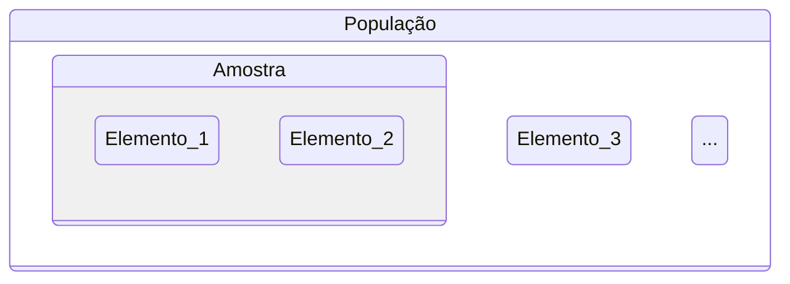
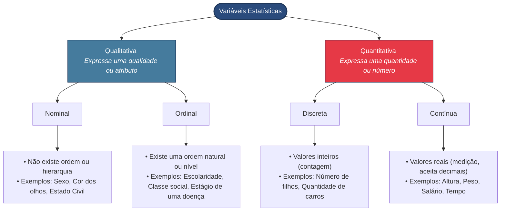
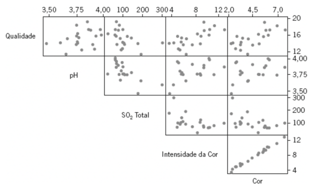

# Motivação

A estatística é a ciência que estuda os dados, resumindo e gerando informação útil sobre eles. Geralmente, as disciplinas de estatística de graduação separam os estudos em Estatística Descritiva e Estatística Inferencial.

> A base que aprendemos de probabilidade será um diferencial para melhor compreensão do que vem a seguir.

A estatística descritiva permite que façamos uma análise exploratória dos dados que temos, montando resumos e estudando a forma como as variáveis se relacionam entre si.

Já a estatística inferencial permite que a gente elabore hipóteses que extrapolem os números que temos à disposição.

## Sobre população e amostra

Enquanto na estatística descritiva estamos trabalhando para entender uma amostra da população, na inferencial elaboramos hipóteses de como é a população através de uma amostra dela.

# Resumo de Dados

Para cada tipo de variável, existem técnicas apropriadas para resumir as informações.

Vamos classificar as variáveis do arquivo de [informações dos empregados da Companhia MB](companhiamb.csv)

## Distribuições de frequência

A variável grau de instrução é Qualitativa Ordinal, para entender melhor, podemos usar contagem para entender a frequência:

| Grau de instrução | Frequência $n_i$ | Proporção $f_i$ | Porcentagem |
| --- | --- | --- | --- | 
| Fundamental | 12 | $0,3333$ | $33,33$ |
| Médio | 18 | $0,5000$ | $50,00$ |
| Superior | 6 | $0,1667$ | $16,67$ |
| Total | 36 | $1,0000$ | $100,00$ |

Para uma variável contínua, como Salário, podemos fazer uma análise parecida aplicando uma *discretização*, definindo o tamanho de um *bin* (ou classes):

| Classe de salários | Frequência $n_i$ | Porcentagem |
| --- | --- | --- |
| $4,00 \vdash 8,00$ | $10$ | $27,78$ | 
| $8,00 \vdash 12,00$ | $12$ | $33,33$ |
| $12,00 \vdash 16,00$ | $8$ | $22,22$ |
| $16,00 \vdash 20,00$ | $5$ | $13,89$ |
| $20,00 \vdash 24,00$ | $1$ | $2,78$ |
| Total | $36$ | $100,00$ |

Para visualizar melhor, podemos usar gráficos como gráficos de barras e pizza para qualitativas e histograma para quantitativas.

# Medidas resumo

Agora nossa intenção é estabelecer valores que nos ajudem a descrever os dados (uma série inteira de 10, 50, 1000 itens) em poucos números.

Como referências práticas, temos as funções [describe() do Pandas](https://pandas.pydata.org/pandas-docs/stable/reference/api/pandas.DataFrame.describe.html) e [summary() do R](https://www.statology.org/summary-function-in-r/)

## Medidas de posição

Essas métricas são usadas como representantes da amostra. Tal como fizemos a análise de valor esperado $E\{X\}$, temos uma paralelo aqui, aplicados à amostra que temos. As medidas de posição comuns para análise exploratória são:

Tomamos $P(X = x)$ como a probabilidade da variável $X$ assumir o valor $x$.

### Média (aritmética)

Pegamos cada $x_i$, mesmo que repetido, contando individualmente. Todos $n$ valores tem chance igual de aparecer, então $P(X = x_i) = \frac{1}{n}$. Então:

$$\bar{x} = \frac{1}{n} \sum_{i = 1}^n x_i$$

### Moda

Valor mais frequente.

$$\text{mo}(X) = \arg \max_{x} P(X = x)$$

⚠️ Distribuições multimodais apresentam mais do que uma moda;

⚠️ No caso de variáveis quantitativas contínuas, precisaria discretizar em classes.

### Mediana

Posição central da série de observações, quando ordenadas em ordem crescente.

Assumindo a série ordenada, temos:

$$\text{md}(X) = \begin{cases}x_{\left( \frac{n+1}{2} \right)}, \quad & \text{se } n \text{ ímpar} \\ \frac{x_{\left( \frac{n}{2} \right)} + x_{\left( \frac{n}{2}+1 \right)}}{2}, \quad & \text{se } n \text{ par}\end{cases}$$

> Apesar dessas três métricas, ainda assim é comum usar mais medidas para descrever melhor os dados.

## Medidas de Dispersão

Exemplo motivador:
- Grupo A (variável X): $3,4,5,6,7$
- Grupo B (variável Y): $1,3,5,7,9$
- Grupo C (variável Z): $5,5,5,5,5$
- Grupo D (variável W): $3,5,5,7$
- Grupo E (variável V): $3,5,5,6,6$

Veja que são grupos bastante diferentes, mas as médias $\bar{x} = \bar{y} = \bar{z} = \bar{w} = \bar{v} = 5,0$.

Vamos então avaliar usando um outro critério, o da variabilidade. Com isso estabelecemos um paralelo a $E\{ (X - \mu)^2 \}$. Usamos, inclusive um argumento parecido de quão longe está da média (que está em um caso em que todos valores são contados unicamente com chance igual). Temos a variância:

$$V(X) = \frac{\sum_{i = 1}^n (x_i - \bar{x})^2}{n}$$

🤔 O argumento usado no Bussab para o $n$ é para possibilitar a comparação entre conjuntos de dados com números diferentes de observações.

Com isso, também definimos o desvio padrão:

$$\text{dp}(X) = \sqrt{V(X)}$$

## Quantis empíricos

Um fato importante: Médias são afetadas por valores extremos. *Outliers* ou Valores extremos (tanto pequenos demais quanto grandes demais) afetam a simetria da distribuição dos dados.

Por isso, a média e, consequentemente, o desvio padrão e a variância, podem não ser ainda suficientes para explicar bem o comportamento dos dados.

Com isso, temos a noção de quantis, que são valores que aparecem em fronteiras da distribuição dos dados.
- $q_1 = q(0,25)$ é o primeiro quartil (abaixo dele tem 25% dos dados)
- $q_2 = q(0,50)$ é o segundo quartil (representa a mediana)
- $q_3 = q(0,75)$ é o terceiro quartil (75% dos dados estão abaixo dele)
- $q_4 = q(1,00)$ é o quarto quartil (o maior valor)

Um recurso muito útil na análise de quantis é o *boxplot*. Estabelecemos a *anatomia* de um *boxplot*:

- DI é a distância interquartil: $DI = q_3 - q_1$.
- O limite superior é $LS = q_3 + 1.5 DI$
- O limite inferior é $LI = q_1 - 1.5 DI$
- O que estiver acima do limite superior ($LS$) ou abaixo do limite inferior ($LI$) é um valor discrepante (ou *outlier*).

# Análise multivariada

Em muitos problemas, engenheiros e cientistas trabalham com dados que são multivariados por natureza; ou seja, cada observação consiste em medidas de várias variáveis.
Exemplos de observações:

- [Dados sobre resistência de fio](./resitencia_fio.csv)
- [Dados sobre a qualidade de vinhos tintos](./vinhos.csv)

> Se já existe um esforço para rodar um experimento ou um ensaio, é natural que se observe mais do que uma variável.

Em uma análise 2 a 2 das varíaves, um gráfico de dispersão pode ajudar a encontrar relação entre as variáveis. Para quantificar, temos o coeficiente de correlação de [Pearson](https://en.wikipedia.org/wiki/Karl_Pearson):

$$r_{xy} = \frac{\sum_{i=1}^{n} y_i (x_i - \bar{x})}{ \left[ \sum_{i=1}^{n} (y_i - \bar{y})^2 \sum_{i=1}^{n} (x_i - \bar{x})^2 \right]^{\frac{1}{2}} }$$

> 🤔 Veja que existe uma certa lembrança dos conceitos de covariância e correlação para variáveis aleatórias em probabilidade conjunta

## Quando temos muitas variáveis

Os conceitos de correlação e dispersão são aplicados para quando queremos comparar 2 variáveis. Se temos $n$ variáveis, temos que comparar dois a dois.

Um procedimento visual seria montar uma matriz de diagramas de dispersão:

📚 Próxima etapa da disciplina é estatística inferencial, vamos fazer mais do que apenas perceber que os conceitos de média, variância e correlação lembram o que vimos em variáveis aleatórias. Vamos estabelecer parâmetros, hipóteses e formalizar essa constatação.
Vamos trazer o Teorema Central do Limite.